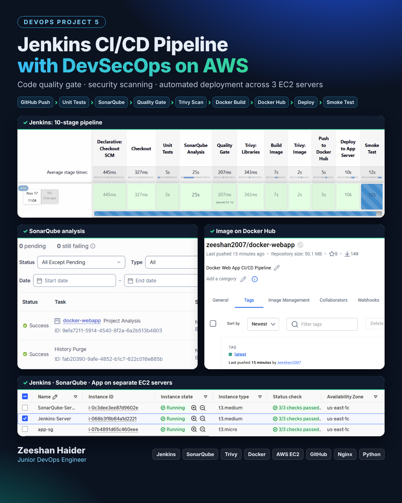
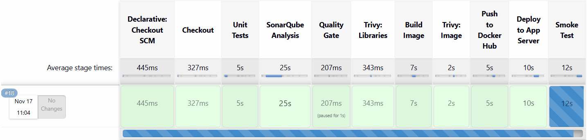
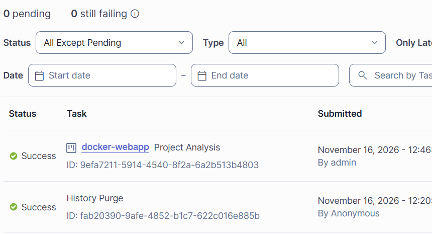
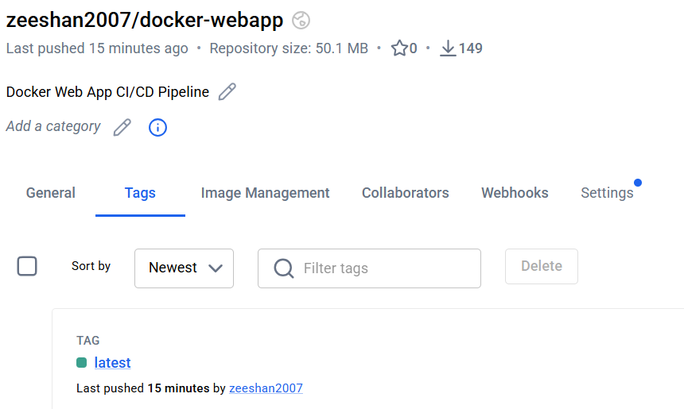
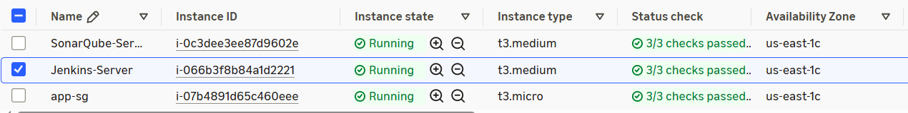

# Jenkins CI/CD Pipeline with DevSecOps on AWS

> A Jenkins pipeline that **tests**, **checks code quality with SonarQube**, **scans for vulnerabilities with Trivy**, **pushes to Docker Hub**, and **deploys over SSH** to a separate application server, using **three dedicated AWS EC2 servers** as in a real company setup.



---

## Overview

| Item | Details |
|---|---|
| **Goal** | Automate test → quality → security → build → deploy for every code change |
| **Application** | Python Flask web app with Redis, behind Nginx (Docker Compose) |
| **CI/CD tool** | Jenkins (self-hosted, declarative `Jenkinsfile`) |
| **Code quality** | SonarQube with a Quality Gate that can stop the pipeline |
| **Security** | Trivy scans of libraries and of the Docker image (critical issues block the release) |
| **Registry** | Docker Hub |
| **Infrastructure** | 3 AWS EC2 servers: Jenkins, SonarQube, App, each with its own security group |

---

## Architecture

```
 Developer pushes to GitHub
        │ webhook
        ▼
┌──────────── JENKINS SERVER ────────────┐        ┌──── SONARQUBE SERVER ────┐
│ 1  Checkout                            │        │  Code analysis           │
│ 2  Unit tests (pytest + JUnit report)  │        │  Quality Gate            │
│ 3  SonarQube analysis ─────────────────┼───────►│                          │
│ 4  Quality Gate  ◄─────────────────────┼────────│  webhook → Jenkins       │
│ 5  Trivy: libraries                    │        └──────────────────────────┘
│ 6  Build Docker image                  │
│ 7  Trivy: image (blocks CRITICAL)      │──push──►  DOCKER HUB
│ 8  Push image                          │                │ pull
│ 9  Deploy over SSH ────────────────────┼──►┌──── APP SERVER ───────────────┐
│ 10 Smoke test ─────────────────────────┼──►│ Nginx → Flask → Redis          │◄── Users :80
└────────────────────────────────────────┘   └────────────────────────────────┘
```

---

## Screenshots

**Jenkins: 10-stage pipeline**


**SonarQube: successful analyses**


**Docker Hub: published image**


**AWS: three separate EC2 servers**


---

## Developer vs DevOps responsibilities

| 👨‍💻 Developer | 🛠️ DevOps (this project) |
|---|---|
| Application code (`app/app.py`, templates) | EC2 servers, security groups, IAM role, key pair |
| Unit tests (`app/test_app.py`) | Installing and configuring Jenkins, SonarQube, Docker, Trivy |
| Dependencies (`requirements.txt`) | Credentials: Docker Hub token, SonarQube token, SSH key |
| Fixing failed tests and quality issues | `Jenkinsfile`, GitHub webhook, Quality Gate, deployment, troubleshooting |

---

## Pipeline stages

| # | Stage | What it does | Stops the pipeline? |
|---|---|---|---|
| 1 | Checkout | Gets the code from GitHub | – |
| 2 | Unit Tests | Runs pytest; results published in Jenkins | ✅ on test failure |
| 3 | SonarQube Analysis | Sends the code to SonarQube | – |
| 4 | Quality Gate | Waits for SonarQube's verdict | ✅ if the gate fails |
| 5 | Trivy: Libraries | Reports HIGH/CRITICAL vulnerabilities in dependencies | Report only |
| 6 | Build Image | Builds the image, tagged with the build number | ✅ on build error |
| 7 | Trivy: Image | Scans the image | ✅ on fixable CRITICAL vulnerabilities |
| 8 | Push to Docker Hub | Pushes `:<build-number>` and `:latest` | – |
| 9 | Deploy to App Server | SSH → copy compose files → `docker compose up -d` | – |
| 10 | Smoke Test | Calls `/health` on the app server | ✅ if the app doesn't answer |

---

## AWS infrastructure

| Resource | Purpose | Key rules |
|---|---|---|
| `jenkins-server` (t3.medium) | Jenkins, Docker, Trivy, Python | SG `jenkins-sg`: 8080 from admin IP, GitHub webhook ranges, and `sonar-sg` |
| `sonarqube-server` (t3.medium) | SonarQube (Docker) | SG `sonar-sg`: 9000 from admin IP and `jenkins-sg` |
| `app-server` (t3.micro) | Nginx + Flask + Redis | SG `app-sg`: 80 from anywhere, SSH 22 **only from `jenkins-sg`** |
| IAM role `devops-ssm-role` | Session Manager access (no SSH from the internet) | `AmazonSSMManagedInstanceCore` |

---

## Jenkins configuration

| Item | Value |
|---|---|
| Plugins | Suggested plugins + SonarQube Scanner, SSH Agent, Pipeline: Stage View |
| Credentials | `sonarqube-token` (secret text), `dockerhub-creds` (username + token), `app-server-ssh` (SSH key) |
| SonarQube server | Name `sonarqube`, private IP of the SonarQube server, port 9000 |
| Scanner tool | `sonar-scanner` (installed automatically) |
| Job | Pipeline from SCM → `Jenkinsfile`, triggered by a GitHub webhook |

---

## Security

- Each server accepts only the traffic it needs; servers talk to each other over **private IPs**
- Jenkins and SonarQube are reachable only from the admin's IP; port 8080 is also open to GitHub's webhook ranges
- The app server accepts SSH **only from the Jenkins security group**
- Secrets live in **Jenkins Credentials** and are masked in logs; Docker Hub uses an **access token**, not a password
- Quality and security **gates** stop bad code and vulnerable images before deployment

---

## Troubleshooting (issues I solved)

| Problem | Fix |
|---|---|
| Quality Gate stage timed out | SonarQube webhook → Jenkins private IP; `jenkins-sg` must allow 8080 from `sonar-sg` |
| `permission denied` on the Docker socket | Add the `jenkins` user to the `docker` group and restart Jenkins |
| Deploy: `Permission denied (publickey)` | SSH credential must use user `ubuntu` and the full private key |
| Jenkins page stopped opening | Home IP changed: update the "My IP" rules |

---

## What I learned

- Installing, configuring and securing Jenkins (plugins, tools, credentials, webhooks)
- Writing a declarative `Jenkinsfile` with stages, post actions and credentials
- Running SonarQube and enforcing a Quality Gate from Jenkins
- DevSecOps with Trivy: scanning dependencies and container images
- Deploying to a separate server over SSH and verifying with a smoke test
- Designing security groups that reference each other across multiple servers

---

## Future improvements

- [ ] Jenkins build agents instead of building on the controller
- [ ] HTTPS for Jenkins and SonarQube
- [ ] Multibranch pipeline with pull-request checks
- [ ] Test coverage reported in SonarQube
- [ ] Slack/email notifications
- [ ] Infrastructure as Code with Terraform

---

## Author

**Zeeshan Haider**: Junior DevOps Engineer
GitHub: [github.com/hzeeshanhaider80-crypto](https://github.com/hzeeshanhaider80-crypto)

*Project 5 of my 10-project DevOps portfolio.*
